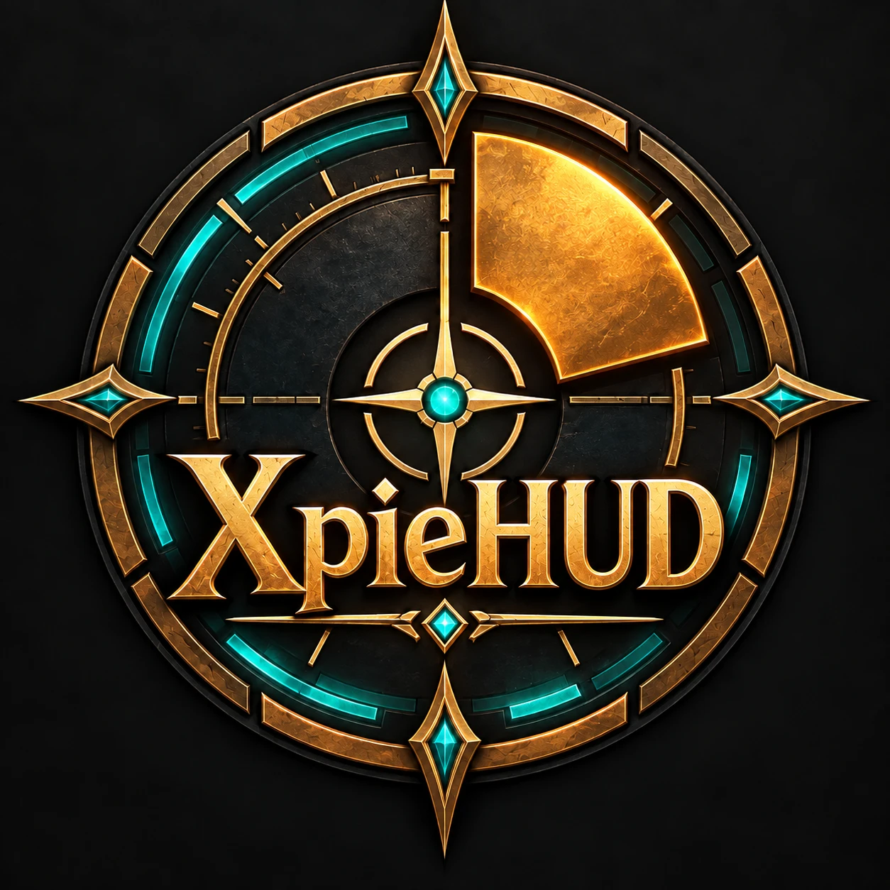

# XpieHUD

Quality-of-life for Blizzard's **native** quest windows, plus optional extensions that restyle popular guide addons to match. Built for Retail (Midnight, 12.1.5) and WoW Forever (1.60).

**Design principle: native, not customisable.** XpieHUD looks like Blizzard shipped it. It uses Blizzard's own art, layouts and colours, and offers only a few native-safe options (opacity, border on/off, spacing) rather than colour pickers and texture lists. It doesn't reskin or replace Blizzard's UI, and it works alongside the default interface and UI suites like Enhance QoL.

The original all-in-one XpieHUD (chat/minimap/bar hiding, chat/meter toggle, RestedXP styling) is preserved on the [`archive/full-v1.2.2`](https://github.com/xpie-29/XpieHUD/tree/archive/full-v1.2.2) branch.

## System Overview

XpieHUD is one **core** addon plus optional **extensions**. Each extension is a separate addon folder, so players load only what they use, and every extension adds its own page under **XpieHUD** in the settings panel.

| Addon (folder) | Role |
|---|---|
| **XpieHUD Core** (`XpieHUD_Core/`) | Required. The quest window features, the settings panel, and the shared systems extensions build on. Useful on its own. |
| **XpieHUD - Zygor Guides** (`XpieHUD_Zygor/`) | Optional extension, requires XpieHUD Core and Zygor Guides Viewer. Gives Zygor the XpieHUD style. |
| **XpieHUD - Baganator** (`XpieHUD_Baganator/`) | Optional extension, requires XpieHUD Core and Baganator. Gives Baganator's bag, bank and guild bank windows the look of Blizzard's Combined Backpack. |

### What XpieHUD Core provides

- **For players:** the quest window features below, and one settings panel for everything.
- **For extensions** (the shared systems, so every extension looks and behaves the same way):
  - **Module registry**: an extension registers itself once and gets saved settings with defaults and upgrades, a settings sub-page, slash commands, and re-applying after settings changes or combat.
  - **Background panels**: native panels an extension anchors behind another addon's window, built from Blizzard's own HUD art. Two looks: **Quest Tracker** (the Objective Tracker's Edit Mode background with its gold header bar and an optional title in the tracker's header font) and **Tooltip** (Blizzard's dark tooltip). The panel resizes, fades and hides with that window. Players control the look, opacity, header bar or border, title text and padding.
  - **Settings kit**: checkboxes, sliders, dropdowns, text boxes and a ready-made panel section, all writing straight to the extension's settings.
  - **Quest window integration**: extensions can offer their frames to the quest window's "Guide Addons" fade.

Writing an extension: see the `RegisterModule` notes at the top of `XpieHUD_Core/Core.lua` and the `CreatePanel` notes at the top of `XpieHUD_Core/Panels.lua`.

## Features

### Quest Window (XpieHUD Core)
Quality-of-life for Blizzard's native quest, gossip and book/plaque windows. There's no reskin: the parchment and campaign themes stay exactly as Blizzard draws them.
- **Hide UI While Talking**: fades action bars, unit frames (including the Personal Resource Display), the objective tracker, chat, the minimap, guide addons and buffs (each can be toggled) while a window is open. Everything comes back on close, or immediately if combat starts.
  - Frames from other addons can be added by name: run `/xhud questscan`, talk to an NPC, and close the window to read what's still visible, then `/xhud questhide <FrameName>`.
- **Tooltips at Cursor**: while talking, tooltips that normally sit in the screen corner appear at the mouse (can be turned off).
- **Position and Size**: drag a window's title bar to move it. A size slider (50–150%) sits in settings. Both are saved and re-applied every time the window opens.
- **Keyboard Shortcuts** (out of combat):
  - **1–9** pick gossip options, quests in an NPC's list, and reward choices.
  - **Space** accepts, continues, completes, or turns a book's page.
  - **Esc** closes the window, as it always has.
  - All other keys pass through, so movement and camera still work. PvP quests and quests that cost gold still need a click.
- **Number Badges & Key Hints**: quests keep their native icon (!, ?, daily, campaign...) with a small number on it; gossip options show the number over a dimmed icon; reward choices get a number in the corner. Also adds small "Space" / "Esc" hints beside the window's own buttons (can be turned off).

### Zygor Guides (XpieHUD - Zygor Guides)
Choose a **Style**:
- **XpieHUD** (default):
  - Zygor's window background, borders, tab strip, toolbar and logo become transparent, and the guide is drawn in Blizzard's native UI font (like the quest tracker) instead of Zygor's own.
  - A **native background panel** sits behind the guide window and resizes with it. Default look **Quest Tracker**: the Objective Tracker's background, with its gold header bar laid over Zygor's title bar and titled "Leveling Guide" in the tracker's header font (any text, or none). Alternative look: **Tooltip**. Adjustable: look, background opacity, header bar / border, title, padding.
  - **Native title bar buttons**: Zygor's menu button becomes Blizzard's gold settings gear (as on the Damage Meter) and its close button becomes Blizzard's red close button, both at Blizzard's own sizes.
  - **Native toolbar**: the step row (arrows, step number, icons) sits on the tracker's section-header art, like "Campaign" or "Quests", with a gold step number and Blizzard's flat arrow icons.
  - **Native guide tabs**: Zygor's guide tabs use Blizzard's chat tab art (like "General / Combat Log"): translucent tabs, a soft gold glow on the selected tab, the chat tab hover highlight, and gold text in the native font.
  - Step boxes keep Zygor's state colours (normal, complete, unavailable) at an adjustable opacity, without edges.
  - **Gold Waypoint Arrow** (can be turned off): a gold arrowhead in Blizzard's HUD style, registered as a native Zygor arrow skin ("XpieHUD Gold", `XpieHUD_Zygor/Media/arrow.tga`, 160 pre-rotated frames). The "you're here" marker is the same arrowhead pointing down; Zygor's stairs / taxi / waiting icons are unchanged.
- **Original**: leaves Zygor's look completely alone. Disabling the extension in the AddOns list removes it entirely.

### Baganator (XpieHUD - Baganator)
Choose a **Style** (needs Baganator's own **Blizzard** skin, under Customise > Theme):
- **XpieHUD** (default): the bag, bank and guild bank windows follow Blizzard's Combined Backpack.
  - The **round portrait** is back in the top-left corner (the bag icon, or the banker at the bank).
  - One **native gear menu** right of the portrait holds Baganator's extra buttons: All Characters, Bank, Guild Bank, Search Everywhere, Saved Searches, Transfer Items and Search Help. Each still does exactly what Baganator's button did.
  - The **Customise** button is gone (Baganator's settings open from its minimap/addon compartment button), and so is the **Bag Slots** button: the native bag bar stays on screen and is used as intended.
  - The native **Clean Up Bags** button sits at the end of the search box, as on the native bag. Right-click still gives Baganator's own sort options.
  - The **Currencies** button matches the gear (same size and square frame, with hover and pressed states) and sits bottom-left, with the coin box to its right. Other bottom buttons become flat, native-size icon buttons.
  - The money line sits in Blizzard's **coin box**.
  - Category sections ("Equipment", "Crafting") look like the Objective Tracker's section headers: the gold bar, the title in the font and gold of a tracker quest name, and its -/+ button at the right end. Category labels use the font and off-white of the tracker's objective lines. Click anywhere on the bar to collapse or expand; right-click still transfers the section.
- **Baganator Profile**: XpieHUD can set each character's Baganator up with its own profile (category layout, icon size, spacing) the first time the character logs in, using Baganator's own import. It becomes the Baganator profile "XpieHUD"; switch profiles in Baganator any time. The XpieHUD settings page can re-apply it or turn this off.
- **Original**: leaves Baganator completely alone. Changing the style takes effect after `/reload`.

---

## Slash Commands

| Command | Description |
|---|---|
| `/xhud` or `/xpiehud` | Open settings panel |
| `/xhud questreset` | Reset quest window position and size |
| `/xhud questscan` | List frames still visible during a quest window (arms for the next NPC if none is open) |
| `/xhud questhide <name>` | Add/remove a frame (case-sensitive) from the fade list |
| `/xhud arrowdebug` | (Zygor extension) Report in chat when Zygor's arrow switches away from the gold sprite |
| `/xhud reset` | Reset all settings to defaults (confirm twice) |

---

## Installation

1. Download the latest release zip
2. Copy `XpieHUD_Core`, plus any extension folders you want (e.g. `XpieHUD_Zygor`), into `World of Warcraft/_retail_/Interface/AddOns/` (or `_classic_beta_/Interface/AddOns/` for the WoW Forever beta). Each must sit directly in `AddOns`, not inside another folder.
3. Restart WoW (a `/reload` is enough when no files were added)

**Upgrading from 3.0.x or earlier:** delete the old `AddOns/XpieHUD` folder. The core is now `XpieHUD_Core`, so WoW saves its settings in a new file. To keep your settings, with the game closed, rename `WTF/Account/<your account>/SavedVariables/XpieHUD.lua` to `XpieHUD_Core.lua`. Zygor settings convert to the new Style choice automatically.

## Requirements

- World of Warcraft Retail (Midnight, Interface 120105) or WoW Forever (Interface 16001). One download covers both.
- Optional: Zygor Guides Viewer, for the XpieHUD - Zygor Guides extension
- Optional: Baganator, for the XpieHUD - Baganator extension

## Notes

- XpieHUD never calls `Hide()`/`Show()` on Blizzard HUD frames. Most are Edit Mode frames, and hiding them from addon code taints Blizzard's layout system (this caused the old world map `ADDON_ACTION_BLOCKED` error). The quest window fades frames by transparency instead, and moves the minimap off-screen because its blips ignore transparency.
- Quest window positioning: if another addon (e.g. Enhance QoL's Move module) also moves `QuestFrame`, `GossipFrame` or `ItemTextFrame`, turn it off there so the two don't fight.
- Upgrading from 1.x: settings for removed features are cleaned out of `XpieHUDDB` automatically. RestedXP's own Active Targets / Active Items options may still be switched off from when XpieHUD managed them; turn them back on in RestedXP if you use it again.

## Version History
- **3.7.3**: Baganator: removed the stray-text hiding and /xhudbag debug command (the doubled title was a stale load, not the code).
- **3.7.2**: Baganator: window background is the native flat panel (FlatPanelBackgroundTemplate, PANEL_BACKGROUND_COLOR) instead of the textured one.
- **3.7.1**: Baganator: every stray header text hidden (no doubled titles); /xhudbag prints background details.
- **3.7.0**: Baganator: window background copied from the native Combined Backpack (texture, tint, transparency).
- **3.6.9**: Baganator: section titles in the bright gold of the Zygor headers and tracker quest names.
- **3.6.8**: Baganator: section titles and -/+ drawn in the bar's own frame on a layer above the bar art, so they always sit over it.
- **3.6.7**: Baganator: section titles reliably draw over the header bar (the shared clip frame took its level from the last header instead of the lowest).
- **3.6.6**: Baganator: section bar's left end mirrors its right (same gap from the window edge); section titles draw above the bar again.
- **3.6.5**: Baganator: section bars run to the window's left edge (clipped to the window) and, like the tracker, past the -/+ button; section titles at 13.
- **3.6.4**: Baganator: section headers in the tracker's quest-name font and gold, category labels in its objective-line font and off-white.
- **3.6.3**: Baganator: section header bars run to the bag window's edges; header titles line up with the first item icon and the -/+ button with the last.
- **3.6.2**: Baganator: section header bars drawn in three slices so their ends keep the tracker's short fade at any window width, placed like the tracker's (art from just before the title to just past the -/+ button).
- **3.6.1**: Baganator: no gap inside the window's left border (the background now sits 2px in, like the native bag, at any column count).
- **3.6.0**: Baganator: category sections ("Equipment", "Crafting") as Objective Tracker section headers (gold bar, tracker font, the tracker's -/+ button). New: set each character's Baganator up with an XpieHUD profile through Baganator's own import (profile still to be added). Currencies button lined up with the coin box.
- **3.5.4**: Baganator: the Currencies button uses the gear's square frame art with its hover and pressed states.
- **3.5.3**: Baganator: the Currencies button is styled like the gear (gear-sized, no button frame, icon glows on hover) at the bottom-left, with the coin box starting to its right.
- **3.5.2**: Baganator: gear tucked against the portrait and centred on the title bar; bottom icon buttons fit the coin box, with their hover glow kept inside the button.
- **3.5.1**: Baganator: the Combined Backpack's smaller portrait corner, gear right of the portrait and above the border, search box clear of the portrait, Clean Up Bags button now appears, bottom button tooltips open below the window. Settings notes no longer overlap the controls under them.
- **3.5.0**: New extension **XpieHUD - Baganator**: Baganator in the style of the Combined Backpack (portrait, one gear menu for its extra buttons, native Clean Up Bags button, flat bottom buttons, coin box; Customise and Bag Slots buttons removed).
- **3.4.5**: WoW Forever support (Interface 16001). Forever runs the retail UI, so the quest window and Zygor styling work unchanged; both addons now list both interface versions. Addon list icon from the new XpieHUD logo.
- **3.4.4**: Tab art trimmed 4px at the bottom so the tabs sit on the toolbar's gold header line.
- **3.4.3**: Chat tab art cropped to the tab height at native scale (its top no longer crosses the header lines); share icon now tints gold when dimmed (sync unavailable) as well as normal.
- **3.4.2**: Zygor add-tab button is the Objective Tracker's native + button; share, report-step, more (…) and more-tabs (») glyphs tinted Blizzard gold (share keeps its green guide-sync colour).
- **3.4.1**: Zygor tab selected glow and hover highlight toned down to 25% opacity.
- **3.4.0**: Zygor's toolbar row (step arrows, step number, icons) styled as an Objective Tracker section header (the art behind "Campaign" / "Quests"); step number in Blizzard's gold with the header shadow; step arrows as Blizzard's flat arrow icons.
- **3.3.1**: Chat tab art drawn at its native 32px height (scaling had put the tab edge through the text); single gold line (tracker art) under the guide tabs.
- **3.3.0**: Zygor guide tabs restyled as Blizzard's chat tabs (translucent, gold selected glow, hover highlight, native font, gold text).
- **3.2.4**: Zygor title buttons at Blizzard's own sizes: gold gear 27px (Damage Meter), red close 24px (standard close button).
- **3.2.3**: XpieHUD style draws Zygor's guide in Blizzard's native UI font (STANDARD_TEXT_FONT, Friz Quadrata in English) instead of Zygor's Open Sans; settings gear nudged 2px down like Blizzard's Damage Meter header.
- **3.2.2**: Zygor title buttons now keep Zygor's own buttons with their art hidden and XpieHUD's gear / close art drawn on top (Zygor could repaint the previous restyle); header bar art overhangs both ends like the tracker's.
- **3.2.1**: Zygor header bar sits on Zygor's own title bar; Zygor's menu and close buttons restyled as Blizzard's gold settings gear and red close button; title starts after the gear, vertically centred like the tracker's.
- **3.2.0**: Panel looks: **Quest Tracker** (default; Objective Tracker background + gold header bar with a custom title, default "Leveling Guide") or **Tooltip**. Falls back to Tooltip with a one-time notice if the tracker art is missing.
- **3.1.0**: Core renamed to `XpieHUD_Core`. New native background panel system in the core (Blizzard's dark tooltip NineSlice; opacity, border, padding) and a settings dropdown widget. Zygor extension gets a Style choice (XpieHUD / Original), an adjustable step box opacity, and a native background panel anchored to the guide window.
- **3.0.0**: Modular layout: `XpieHUD` core (quest window, settings, module registry) plus the `XpieHUD_Zygor` extension addon. Each extension gets its own settings sub-page; Zygor settings migrate automatically.
- **2.0.2**: Zygor "you're here" marker uses the gold arrowhead pointing down instead of Zygor's green arrow (it flickered in when flying over a waypoint)
- **2.0.1**: `/xhud arrowdebug` diagnostic for the Zygor arrow
- **2.0.0**: Slimmed down to the quest window features and the Zygor integration (everything else moved to Enhance QoL; full version archived on `archive/full-v1.2.2`). Updated for 12.1.5. Obsolete settings pruned on load.
- **1.2.2**: Fix ADDON_ACTION_BLOCKED (SetPropagateKeyboardInput) when reloading in combat; quest keys reset to pass-through on key release
- **1.2.1**: Zygor title logo hidden with the window chrome; Zygor step boxes at 50% opacity
- **1.2.0**: Zygor Guides integration (transparent window, 30% step boxes, gold arrow skin); guide addon selector (RestedXP / Zygor / both); quest fade "RestedXP" option is now "Guide Addons"
- **1.1.6**: Gold arrowhead replaces the RestedXP waypoint arrow (toggle in settings)
- **1.1.5**: Fix world map `ADDON_ACTION_BLOCKED` (SetPropagateMouseClicks) and Objective Tracker secret-aura taint: Blizzard frames are now hidden by alpha + mouse instead of Hide(); minimap moved off-screen instead of hidden; chat shows while typing when hidden
- **1.1.4**: RestedXP step frame background darkened to 30%
- **1.1.3**: Quest entries keep their native icon with a small gold number on it (options keep the dimmed-icon number); tooltips at cursor while talking; fade Personal Resource Display and MicroButtonAndBagsBar; badge/hint offsets tuned in game
- **1.1.2**: Gold number badges; badge and key-hint alignment; chat shows while typing mid-dialog; `questscan` arms itself for the next NPC and skips frames it cannot inspect
- **1.1.1**: Title-bar drag handle; badges moved onto option icons; Space/Esc key hints; minimap fully hidden while talking; RXP arrow and chat/meter button fade; `questscan`/`questhide`; fixed `/xhud meterframe <name>` (was lowercased and mis-parsed)
- **1.1.0**: Native quest window QoL: hide UI while talking, saved position and size, 1–9/Space keys, number badges

- **1.0.9** — Removed quest tracker width (protected frame limitations in TWW)
- **1.0.8** — Quest tracker width attempt via sub-tracker frames
- **1.0.7** — Quest tracker width auto-detects live value on login
- **1.0.6** — Quest tracker width targets correct content frames
- **1.0.5** — Meter frame OnShow hook prevents data-driven re-shows
- **1.0.4** — Quest tracker width slider (Settings panel)
- **1.0.3** — Meter frame scanner and manual name persistence via `/xhud meterframe`
- **1.0.2** — Chat/meter toggle redesign; frame-based click detection; correct chat routing
- **1.0.1** — Settings panel scroll frame
- **1.0.0** — Chat/Meter 3-state toggle with movable button
- **0.9.x** — RestedXP border strip; Active Targets/Items hide; Bindings.xml modernisation
- **0.2.0** — Initial release: chat/minimap toggle, status bar/micro menu/bag bar hide, extra abilities scale
